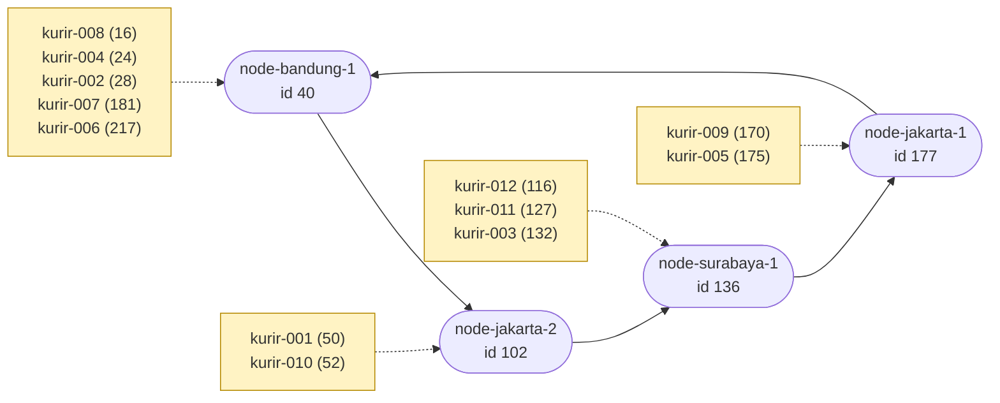

# Tugas 6 (Pekan 6) — Penamaan & Resolusi Lokasi

**Materi terkait:** Flat Naming, Structured Naming (DNS), Distributed Hash Table (DHT)/Chord.

## Studi Kasus

Pelanggan FoodGo kesulitan menemukan alamat IP server kurir yang **dinamis** (kurir berpindah lokasi/jaringan, IP-nya sering berubah). FoodGo butuh cara memetakan **ID Kurir** (identitas tetap) ke **alamat IP terkininya** tanpa server pusat tunggal yang jadi bottleneck/single point of failure.

## Tugas Kelompok

Implementasikan **simulasi Chord DHT** sederhana (single-process, tidak perlu jaringan sungguhan — cukup simulasi struktur data & algoritma di satu program Python) yang memetakan ID Kurir ke alamat IP mereka.

Konsep yang harus terlihat jalan dalam simulasi kalian:
1. **Consistent hashing**: ID Kurir dan ID Node di-hash ke ruang angka yang sama (mis. 0–255 untuk kesederhanaan, `m=8` bit).
2. **Ring topology**: node-node diurutkan melingkar berdasarkan hasil hash-nya.
3. **Lookup**: fungsi `lookup(kurir_id)` yang menemukan node mana yang bertanggung jawab menyimpan mapping ID Kurir tersebut → alamat IP-nya (aturan Chord: node dengan ID hash **terkecil yang lebih besar atau sama dengan** hash key, disebut *successor*).
4. **Perubahan topologi**: simulasikan minimal satu node baru bergabung (`join`) atau satu node keluar (`leave`), tunjukkan bagaimana mapping berpindah tanggung jawab ke node lain.

Skeleton disediakan di `src/chord_simulation.py` dengan fungsi hashing dan struktur ring sudah ada — bagian `lookup()`, `join()`, dan `leave()` sengaja dikosongkan.

### Cara Menjalankan

```bash
python3 src/chord_simulation.py
```

## Tugas Analisis (`README.md`)

1. Jelaskan **kenapa DHT/Chord** lebih cocok untuk kasus ini dibanding **flat naming sederhana** (mis. tabel pusat ID→IP) atau **DNS konvensional** — kaitkan dengan sifat "IP kurir sering berubah" dan kebutuhan tanpa titik gagal tunggal.
2. Gambarkan (boleh pakai Mermaid, lihat Tugas 2) ring topology dari simulasi kalian, tandai node mana yang bertanggung jawab atas ID Kurir mana.
3. Jelaskan apa yang terjadi pada mapping saat sebuah node **keluar** dari ring (siapa yang mengambil alih tanggung jawabnya) — dukung dengan output program.

## Struktur Submission

```
tugas-06-penamaan-dht/
├── README.md      # Analisis + diagram ring
├── JURNAL.md
├── src/
│   └── chord_simulation.py
└── bukti/          # Output program (screenshot/log) untuk skenario join & leave
```

---

# Jawaban Tugas Analisis

Semua angka di bawah diambil dari hasil menjalankan `src/chord_simulation.py`. Log lengkapnya ada di [bukti/output_simulasi.txt](bukti/output_simulasi.txt).

## 1. Kenapa Chord, bukan tabel pusat atau DNS

Masalah FoodGo ada dua: IP kurir sering berubah, dan tidak boleh ada satu server yang kalau mati semuanya ikut berhenti.

Tabel pusat ID→IP paling gampang dibuat, tapi semua beban numpuk di satu tempat. Setiap kurir pindah jaringan harus update ke server itu, dan setiap pelanggan yang mencari kurir juga bertanya ke server itu. Kalau kurirnya banyak, server ini jadi bottleneck. Kalau mati, tidak ada satu pun kurir yang bisa ditemukan.

DNS memang terdistribusi, tapi dirancang untuk nama yang jarang berubah. Kecepatannya datang dari cache yang berlaku selama TTL. Kalau IP kurir berubah tiap beberapa menit, resolver bisa masih memberi IP lama sampai TTL habis. TTL bisa dikecilkan, tapi cache jadi tidak banyak gunanya dan query kembali menumpuk di authoritative server zona FoodGo. Selain itu kekuatan DNS ada di nama berstruktur, sedangkan ID Kurir itu ID datar tanpa hierarki.

Di Chord, mapping dibagi ke semua node berdasarkan hash. Update IP cukup ke satu node, yaitu successor dari hash kurir itu, dan tidak ada node yang menyimpan semuanya. Di simulasi kami, mengganti IP kurir-001 hanya menyentuh node 102. Saat topologi berubah, yang pindah juga cuma sebagian kecil: join node-medan-1 memindahkan 1 dari 12 kurir, dan leave node-jakarta-1 memindahkan 2 dari 12 kurir. Sisanya tidak terganggu.

Ada beberapa hal yang disederhanakan di simulasi ini, dan perlu dicatat supaya kesimpulannya tidak berlebihan:

- `find_successor` melihat semua node sekaligus. Di Chord asli tiap node hanya kenal sebagian node lewat finger table, dan lookup butuh sekitar O(log N) hop.
- `leave` di sini keluar baik-baik, jadi datanya sempat dioper. Kalau node mati mendadak dan tidak ada replikasi ke successor berikutnya, datanya hilang. Jadi "tanpa titik gagal tunggal" baru benar-benar tercapai kalau ada replikasi.
- Beban tidak rata. Di ring awal node 40 memegang 5 dari 12 kurir karena rentangnya paling lebar (119 dari 256 id). Virtual node bisa mengurangi ini.
- Ruang id 8 bit gampang tabrakan. kurir-012 dan kurir-024 sama-sama dapat hash 116, jadi pendaftaran yang kedua ditolak program. Di Chord asli yang 160 bit, hal ini praktis tidak terjadi.

## 2. Diagram ring

Urutan node searah putaran ring: 40 → 102 → 136 → 177 → kembali ke 40. Kotak kuning berisi kurir yang dipegang tiap node, angka dalam kurung adalah hash-nya.



| Node | ID | Rentang hash | Kurir |
|---|---|---|---|
| node-bandung-1 | 40 | 178–255 dan 0–40 | kurir-002, 004, 006, 007, 008 |
| node-jakarta-2 | 102 | 41–102 | kurir-001, 010 |
| node-surabaya-1 | 136 | 103–136 | kurir-003, 011, 012 |
| node-jakarta-1 | 177 | 137–177 | kurir-005, 009 |

kurir-006 (217) dan kurir-007 (181) hash-nya lebih besar dari semua id node, jadi memutar ke node terkecil, yaitu 40.

Saat node-medan-1 (id 123) bergabung, rentang 103–123 yang tadinya milik node 136 diambil node baru ini. Hanya kurir-012 (116) yang ada di rentang itu, jadi hanya dia yang pindah:

```
[JOIN] Node 'node-medan-1' (id=123) bergabung, alamat 10.0.0.5
  kurir-012 (hash=116) pindah dari node 136 ke node 123
```

## 3. Apa yang terjadi saat node keluar

Node yang keluar di simulasi adalah node-jakarta-1 (id 177). Semua key yang dipegangnya diambil alih oleh successor-nya. Karena 177 adalah id terbesar di ring, successor-nya memutar ke node 40.

```
[LEAVE] Node 'node-jakarta-1' (id=177) keluar dari ring
  kurir-005 (hash=175) pindah dari node 177 ke node 40
  kurir-009 (hash=170) pindah dari node 177 ke node 40
```

Lookup setelahnya tetap berhasil dan IP-nya tidak berubah, yang berubah hanya node penanggung jawabnya:

```
[LOOKUP] kurir-005 (hash=175) ditangani node 40
kurir-005 -> 192.168.1.14
[LOOKUP] kurir-009 (hash=170) ditangani node 40
kurir-009 -> 192.168.1.18
```

Sebelumnya kurir-005 ditangani node 177 dengan IP yang sama. Kurir lain tidak ikut pindah, misalnya kurir-001 tetap di node 102 dan kurir-002 tetap di node 40. Hanya node 40 yang isinya bertambah, dari 5 menjadi 7 kurir:

```
  node 40 (10.0.0.3): kurir-008(16), kurir-004(24), kurir-002(28), kurir-009(170), kurir-005(175), kurir-007(181), kurir-006(217)
  node 102 (10.0.0.2): kurir-001(50), kurir-010(52)
  node 123 (10.0.0.5): kurir-012(116)
  node 136 (10.0.0.4): kurir-011(127), kurir-003(132)
```
